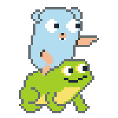
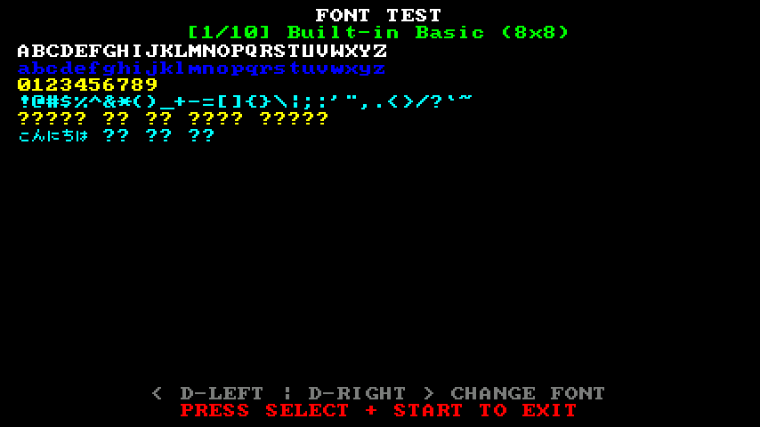
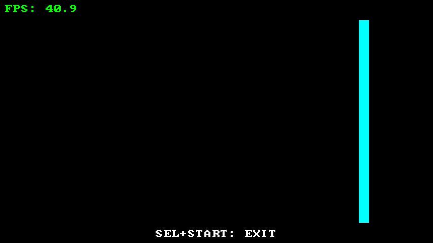
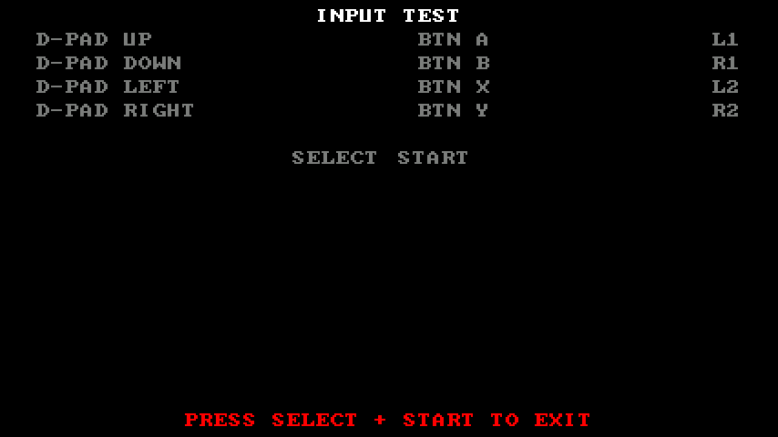
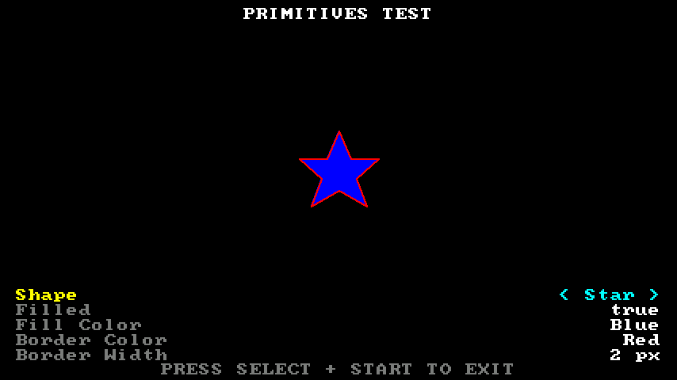

# GoFroggy

<div align="center">
  
</div>

A (very) basic framework to build applications in Go for Data Frog SF3000 devices that are running [TreeFrogUI](https://github.com/tzubertowski/TreeFrogUI).

> [!IMPORTANT]
> [TreeFrogUI](https://github.com/tzubertowski/TreeFrogUI) supports multiple devices, but this framework was tested only on the SF3000.
> It **MAY** work with the others that uses similar hardware, but modifications can be needed.

## What it does

GoFroggy gives your Go program basic interaction with the system:

- **Display:** frames are shown through the functions of the `driver_sf3000.so` shared object (now it also is capable of direct framebuffer control).
- **Input:** buttons are read from the shared memory of the `cubevol` process (the one TreeFrogUI runs).

On top of that it offers:

- A built-in 8x8 bitmap font (adapted from https://github.com/dhepper/font8x8)
- Font management with TTF/OTF support and text shaping, including right-to-left scripts (powered by https://github.com/go-text/typesetting)
- As expected from something that allows font use... it draws text
- A drawer for primitives (circle, line, rectangle and polygon)
- Basic scene control (update, draw and flow control)
- Render scaling: draw small, let the driver stretch the frame to the panel (fractional downscale), plus optional vSync
- Three display backends: one that needs no cgo (with a helper process), one that loads the driver in-process (cgo) and one that controls the framebuffer directly
- PNG screenshots

## Requirements

- Go 1.27 or newer.
- An SF3000 running TreeFrogUI. The `cubevol` process must be running while your program runs, because input is read from it.
- `driver_sf3000.so` on the device. It is looked up in the working directory, then in `/mnt/sdcard/cubegm` (or set `Config.DriverPath`, not needed if using the `fb` backend).
- For the bridge backend, the `driver_bridge` executable (same lookup folders or `Config.BridgePath`).
- To build for the device use a MIPS cross toolchain. The `maheshivara/sf3000-toolchain` Docker image has one (little-endian MIPS32r2, hard float, glibc).

## Quick start

A minimal program:

```go
package main

import (
	"time"

	"github.com/Maheshivara/gofroggy/pkg/gfx"
	"github.com/Maheshivara/gofroggy/pkg/gfx/text"
	"github.com/Maheshivara/gofroggy/pkg/hardware/display"
	"github.com/Maheshivara/gofroggy/pkg/hardware/input"
	"github.com/Maheshivara/gofroggy/pkg/hardware/input/mapping"
)

func main() {
	disp, err := display.NewDisplayController(display.Config{
		Backend:   display.BackendBridge,
		Downscale: 1.9, // renders 448x252; the driver stretches it to 854x480
	})
	if err != nil {
		panic(err)
	}
	defer disp.Close()

	in, err := input.NewInputController(nil)
	if err != nil {
		panic(err)
	}
	defer in.Close()

	drawer := gfx.NewDrawer(disp)
	font := text.LoadFont("", 20)
	_, sy := disp.Scale()
	font.SetScale(sy)
	ascent, _ := font.GetMetrics()

	ticker := time.NewTicker(time.Second / 60) // 60 Hz
	defer ticker.Stop()

	for {
		in.Update()
		if in.IsPressed(mapping.SELECT) && in.IsPressed(mapping.START) {
			return
		}

		disp.Clear(0x0000)
		drawer.Text.DrawText(font, "Hello, Frog!", 20, 20+ascent, 0xFFFF)
		if err := disp.Update(); err != nil {
			return
		}
		<-ticker.C
	}
}
```

Build and run:

```sh
# Go program, bridge backend (no cgo)
CGO_ENABLED=0 GOOS=linux GOARCH=mipsle go build -o app .

# Bridge helper, built with the toolchain's gcc
$GCC -O2 -o driver_bridge driver_bridge.c -ldl
```

Copy `app` and `driver_bridge` to the device (next to `driver_sf3000.so`, or into `/mnt/sdcard/cubegm`) and run `app` while TreeFrogUI is running (as currently TreeFrogUI doesn't have a sideloading option, you will have to overwrite some of the existent standalone, **I** recommend that you rename of `image_viewer` to `image_viewer.bkp` and put the app with the name `image_viewer`).

To use the direct backend instead, build with `CGO_ENABLED=1` and the toolchain's gcc as `CC`, and set `Backend: display.BackendDirect`.

### Examples

There are some examples on the [./examples](./examples) dir those are:

| Example    | Screenshot                                     | Description                                                                        |
| ---------- | ---------------------------------------------- | ---------------------------------------------------------------------------------- |
| Font       |         | A bunch of text with various origins and a font loader (from the TreeFrogUI fonts) |
| FPS        |           | Just a blue bar running on screen with a FPS meter                                 |
| Input      |       | Screen where every button pressed is indicated                                     |
| Primitives |  | Small playground with some options to test the framework primitives                |

## Display

### Logical and render size

Two sizes are involved:

- The render size is the size of the frame buffer (`Width()`, `Height()`).
- The logical size is the panel size (`LogicalSize()`, 854x480 on the SF3000).

Lay out your screen in logical pixels. The drawing helpers (`primitives`, `text`) take logical coordinates and scale them to the render size, so the picture keeps its layout at any downscale. Anything you write directly with `SetBuffer()` or with `SetPixel` is in render pixels.

`Stats()` returns the active settings and the latest timings (copy, vsync wait, driver call), which helps when profiling.

The `fb` display controller try to get the display rotation from the hcge config, but you can set/override with the `Config.Rotation`.

### Performance notes

Measured on one SF3000 with continuous presentation (FPS example), no vSync and no `update_screen`:

| Driver controller | Downscale | FPS |
| ----------------- | --------- | --- |
| fb                | 1         | ~40 |
| bridge            | 1         | ~25 |
| direct            | 1         | ~40 |

> [!TIP]
> If you are experiencing tearing at high sizes, it go away with vSync and update_screen (performance wise vSync is better), but expect a FPS drop.

Tips:

- The `Update()` ignores frames that doesn't changed, but it comes with a cost of the comparison, if your app changes the frames constantly, disabling it (by the `DisableFrameCheck` config option) can improve the performance.
- Choose the render size once at startup. Changing it while running can make the driver misbehave (thanks for the contributors of [hwdisp.c](https://github.com/tzubertowski/TreeFrogUI_picoarch/blob/2331945330b7881f80790fdc0bd089bb117a185c/hwdisp.c) that tested and did the hard work).
- Write with `SetBuffer()` directly for heavy drawing; calling `SetPixel` for every pixel is slow.

## Drawing and text

- **Primitives:** `gfx.NewDrawer(disp)` gives you `drawer.Primitives` (`DrawRectangle`, `DrawRoundedRect` `DrawCircle`, `DrawEllipse` `DrawLine`, `DrawPolygon`) and `drawer.Text`.
- **Fonts:** `text.LoadFont(path, size)` loads a TTF or OTF file at a logical size. With an empty path, or if loading fails, it falls back to the built-in 8x8 font, which only scales in whole-pixel steps.
- **Layout:** `MeasureText` and `GetMetrics` return logical pixels. Call `font.SetScale(sy)` after creating the display so they are right from the first frame.
- **Screenshots:** `disp.SaveScreenshot(dir)` and `SaveScreenshotAsync(dir)` write numbered PNG files.

## Input

`input.NewInputController(mapping)` reads the buttons from `cubevol`. Call `Update()` once per frame, then use `IsPressed` or `IsJustPressed` with a mapped button,

Pass `nil` for the default mapping, or build your own with `mapping.NewInputMappingBuilder()` and change it later with `Remap`.

## Scenes

The `scene` package keeps a stack of scenes; the top one is active. Implement the `Scene` interface (`Init`, `Update`, `Draw`, `HandleInput`, `Pause`, `Resume`, `Destroy`) and use `Push`, `Pop` or `Switch` on the `SceneManager` to move between screens.

## Troubleshooting

| Problem                                                     | Likely cause                                                                                                                                                                                                                     |
| ----------------------------------------------------------- | -------------------------------------------------------------------------------------------------------------------------------------------------------------------------------------------------------------------------------- |
| `ERR dlopen ...` or `driver has no video_driver_disp_frame` | `driver_sf3000.so` is missing or is the wrong file. Check the lookup folders or set `DriverPath`.                                                                                                                                |
| Tearing or low fps                                          | See the performance notes above.                                                                                                                                                                                                 |
| cgo build says `stdint.h: No such file`                     | Go adds its own `-march` flag, which conflicts with the toolchain. Point `CC` at a small wrapper script that drops Go's `-march`, `-mabi` and float flags and passes `-march=mips32r2` once (see [mips-gcc](./docker/mips-gcc)). |

## Credits

- [TreeFrogUI](https://github.com/tzubertowski/TreeFrogUI) project family, for allowing those small devices to fly higher than anyone has imagined.
- [NocturnalRTOS](https://github.com/Data-Frog-Central/NocturnalRTOS) project, from where I got the how-to of the framebuffer manipulation.
- [font8x8](https://github.com/dhepper/font8x8), for the built-in bitmap font.
- The contributors of the open source libs used in this project.
